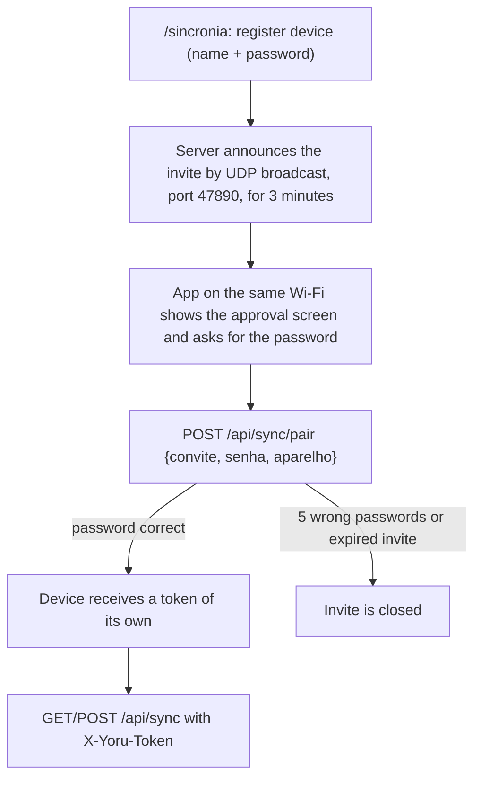

# 🌃 Yoru (夜)

**A personal organizer that runs on your own computer, with an Android app that syncs over the local network.**

🌐 **English** · [Português](README.pt-BR.md)

Work, studies, readings, college and goals in one place, stored in a local SQLite file.

     

---

## 📌 About

Yoru is a FastAPI server with HTML pages that you open in the browser on the same computer, plus a native Android app (Kotlin) that keeps a local copy of the data and syncs when the server is on.

> **Project status:** personal project, used daily by the author. There is no published release and there are no automated tests yet. The database, the tokens and the logs stay in `data/`, outside the repository.

The core idea is local-first data:

> 💾 **The data lives in a SQLite file on your computer** (`data/yoru.db`; a backup is a copy of this file).
> 📱 **The phone works offline and syncs when it can reach the server.**

## 📑 Table of Contents

- [Technologies](#-technologies)
- [Features](#-features)
- [The process](#-the-process)
- [What I learned](#-what-i-learned)
- [How can it be improved](#-how-can-it-be-improved)
- [Running the project](#-running-the-project)
- [License](#-license)

---

## 🛠 Technologies

| Area | Technology |
| --- | --- |
| Server language | Python 3 |
| Framework | FastAPI + Uvicorn |
| Persistence | SQLModel on SQLite |
| Pages | Jinja2 templates, CSS and a small script of its own (`app/static/yoru.js`, no dependencies, works offline) |
| Mobile app | Kotlin 2.0.21, Jetpack Compose (Material 3), Navigation Compose |
| Mobile storage | Room 2.6.1 (SQLite) |
| Mobile network | OkHttp 4.12.0 + kotlinx.serialization |
| Android build | Android Gradle Plugin 8.7.3, Gradle 8.11.1, JVM target 17, `minSdk` 26, `targetSdk` 35 |

---

## 🚀 Features

### 🖥 Screens (web)

- **Hoje** (`/`): greeting, where you stopped and the next step, the day's ensō, deadlines, today's tasks and quick capture.
- **Caixa de entrada** (`/caixa`): write without thinking; later move each item to an area.
- **Faculdade**: courses with schedule and average, exams and deliveries with the row of moons until the next exam, college tasks.
- **Leituras**: current book with the ensō of the pages, the "want to read" queue, books of the year against the goal and consistency (days in a row, pages per day).
- **Estudos**: subjects with progress, session log (minutes and advance), weekly goal in hours and materials.
- **Trabalho, Pessoal** and other areas: in progress, next, the area's objective and courses or materials in progress.
- **Metas** (`/metas`): objectives per area, each with measurable goals. Goals in "books" and in "hours per week" measure themselves.
- **Closing an area**: at the end of each area's page (and on the area screen in the app), "Encerrar <área> por hoje" records what was done, where you stopped and the next step for that area only, without closing the day. Closing again on the same day updates the summary.
- **Começar o dia** (Hoje screen): the last pending summary of each area; the next steps you tick become today's tasks, the others are dismissed.
- **Encerrar o dia** (`/encerrar`): the same summary for one area, plus the option to carry open tasks over to tomorrow.
- **Diário** (`/diario`): all the closed days.
- **Foco** (`/foco`): Pomodoro with adjustable times (focus, break, long break, every how many focus rounds), area and task of the session; the sessions go into Progresso.
- **Hábitos** (`/habitos`): one moon per day, streak, times per week; today's habits also appear on the Hoje screen.
- **Progresso** (`/progresso`): today, this week, this month. Tasks done, focus minutes, study minutes, pages read and % of habits, in bars.
- **IAs** (`/ias`): how much of the 5-hour session and of the week has been used in Claude Code and in ChatGPT Plus (Codex), with the time of each reset, and the cost and tokens of the Anthropic API. Each account is linked through the CLI login on this computer (`claude`, `codex login`) or by pasting a token; the API asks for an Admin API key. The links are stored in `data/ia_contas.json`, outside git.
- **Sincronia** (`/sincronia`): address and token to connect the phone, the list of devices and the sync history.

### 📱 Android app

It lives in `android/`. It keeps a local copy of the data (Room/SQLite) and syncs with the server through `/api/sync`: when it opens and through the "Atualizar agora" button on the Sincronia tab. Screens available: Hoje, Caixa, Áreas, Foco, Hábitos, Progresso and Sincronia.

A guide to the language for people coming from Java is in `android/GUIA-KOTLIN.md`.

### 🔌 JSON API

The interactive documentation is at `http://127.0.0.1:8000/docs`.

---

## 🔄 The process

### 1. Data model

```
Área → Objetivo → Meta → Tarefa
Recurso   book, course, college course (with progress)
Evento    exam, delivery, meeting (date and time)
Registro  logbook: where I stopped, next step
Nota      free text linked to any item
```

Every synced table has `id` (UUID), `created_at`, `updated_at`, `deleted_at` and `synced_at`. These fields support the phone ↔ PC synchronization.

When a model gains an optional field, the column is created in the database when the server starts (`add_missing_columns` in `database.py`).

### 2. Pairing a device



The page lists the devices and lets you revoke each one. If the announcement does not arrive (a router that blocks broadcast), use "Conexão manual": address and general token typed into the app.

With the server open to the network, only `/api/sync` (with token or pairing) and `/api/health` answer other devices; the pages and the rest of the API remain valid only on this computer. Use it only on a trusted network.

### 3. Sync protocol

The server is passive: the app starts the sync. Always with the `X-Yoru-Token` header:

```
GET  /api/sync?desde=<cursor>   downloads what changed (without "desde": everything)
POST /api/sync                  {"dispositivo": "celular", "desde": "<cursor>",
                                 "mudancas": {"task": [ {...}, ... ], "event": [ ... ]}}
```

The response brings `cursor` (keep it and send it as `desde` next time), `mudancas` (what the device is missing), `aplicados`, `ignorados` and `rejeitados` (with the reason for each). Rules:

- Conflict: the most recent `updated_at` wins; a tie stays with the server.
- A deletion is a record with `deleted_at`; the app must also send and keep these tombstones.
- Resending the same batch is safe. A faulty record is rejected without bringing down the batch.
- Timestamps in UTC with 6 decimal places (`2026-10-31T18:45:12.123456Z`); times set by the user (exam at 7 pm) have no time zone. A timestamp more than 5 minutes in the future becomes the server's "now".
- Areas and tags have a unique name: the app must download before creating.

### 4. Project layout

```
yoru/
├── app/
│   ├── main.py        # FastAPI entry point
│   ├── database.py    # SQLite connection (data/yoru.db)
│   ├── models.py      # all tables (SQLModel)
│   ├── crud.py        # create / list / update / delete (soft)
│   ├── sync.py        # sync engine (conflicts, tombstones, token)
│   ├── pairing.py     # pairing: UDP invite, password, token per device
│   ├── services_track.py  # habits, focus sessions, progress per period
│   ├── routers/       # API routes per entity and pages
│   ├── templates/     # HTML pages
│   └── static/        # CSS and JS
├── data/yoru.db       # your database; backup = copy this file
├── android/           # mobile app (Kotlin, Jetpack Compose, Room)
├── seed.py            # default areas
└── requirements.txt
```

---

## 📚 What I learned

### Offline-first sync

Giving every table a UUID `id` plus `updated_at`, `deleted_at` and `synced_at` is what makes it possible for two copies of the data to change separately and meet later. I learned to treat deletion as a record (a tombstone), to resolve conflicts by the most recent `updated_at`, and to make a resent batch safe.

### One token per device

Pairing gives each device its own token, so one phone can be revoked without affecting the others. The invite password is never sent in the announcement and is kept only as a hash while the invite lives, with a limit of attempts.

### Derived progress

Goals in "books" and in "hours per week" are calculated from the records (finished books, study sessions) instead of being typed in, so the record stays the single source of truth.

### Opening only what is needed to the network

When the server listens on the home network, a middleware lets other devices reach only `/api/sync` and `/api/health`; the pages stay restricted to the computer itself.

### Clocks disagree

The phone's clock and the server's clock are not the same. Using UTC for the sync timestamps and correcting a timestamp that is too far in the future avoided records that would always win a conflict.

### A local copy on the phone

On Android, the screens read from Room and the sync runs separately, so the app works without the server.

---

## 🔮 How can it be improved

| Improvement | Description |
| --- | --- |
| **Automated tests** | There are none yet, on the server or in the app. The sync engine is the first candidate. |
| **Missing screens in the app** | Leituras, Faculdade and Estudos exist only on the web. |
| **Weekly review** | Planned in the roadmap, not started. |
| **Subscription limits** | On the IAs screen, the subscription limits come from internal endpoints of the CLIs themselves, which can change without notice. |
| **Sync beyond the home network** | The sync works only on the local network, and should be used only on a trusted one. |
| **Schema migrations** | Today the server only creates missing columns for new optional fields at start-up. |
| **Published release** | There is no published release; the APK is built from source. |

---

## ▶ Running the project

### Requirements

- Python 3
- Git
- Windows for the `.bat` and `.ps1` scripts (the steps below use PowerShell)
- For the app: Android Studio, or Gradle with JDK 17

### 1. Clone the repository

```bash
git clone <repository-url>
cd yoru
```

### 2. Easy way (Windows)

Double-click `Iniciar Yoru.bat`. The first time it creates the Python environment, installs the dependencies and the default areas; after that it only starts the server in the background (open to the home network, so the phone can sync) and opens Yoru in the browser. If it is already on, it only opens the browser. To turn it off, use `Parar Yoru.bat`.

### 3. Manual way

```powershell
python -m venv .venv
.\.venv\Scripts\Activate.ps1
pip install -r requirements.txt
python seed.py                      # creates the default areas
uvicorn app.main:app --reload       # server at http://127.0.0.1:8000
```

Open `http://127.0.0.1:8000` to use Yoru, or `http://127.0.0.1:8000/docs` for the API. Next time, only `.\.venv\Scripts\Activate.ps1` and `uvicorn app.main:app --reload`.

### 4. Open the server to the phone

```powershell
uvicorn app.main:app --host 0.0.0.0 --port 8000
```

`run.ps1` does the same with automatic reload. Then open `/sincronia` on the computer and use **Cadastrar aparelho**.

If the phone receives the invite but cannot reach the server, Windows is blocking the port. In PowerShell as administrator, once:

```powershell
New-NetFirewallRule -DisplayName "Yoru 8000" -Direction Inbound -Protocol TCP -LocalPort 8000 -Action Allow -Profile Private,Public
```

Test in the phone's browser: `http://<pc-ip>:8000/api/health` should answer with `"status":"ok"`.

### 5. Build the Android app

Open the `android/` folder in Android Studio (File → Open), wait for Gradle to sync and run it on the phone or the emulator with the Run button. From the command line, with Gradle installed:

```bash
cd android
gradle :app:assembleDebug
```

Install the generated APK; Android asks you to allow "install unknown apps".

### Running the tests

There are no automated tests yet.

---

## 📄 License

MIT. See [LICENSE](LICENSE).
