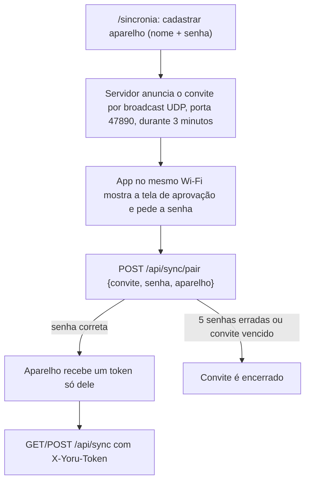

# 🌃 Yoru (夜)

**Um organizador pessoal que roda no seu próprio computador, com um app Android que sincroniza pela rede local.**

🌐 [English](README.md) · **Português**

Trabalho, estudos, leituras, faculdade e metas em um só lugar, guardados num arquivo SQLite local.

     

---

## 📌 Sobre

O Yoru é um servidor FastAPI com páginas HTML que você abre no navegador do mesmo computador, mais um app Android nativo (Kotlin) que guarda uma cópia local dos dados e sincroniza quando o servidor está ligado.

> **Estado do projeto:** projeto pessoal, em uso no dia a dia do autor. Não há versão publicada nem testes automatizados ainda. O banco de dados, os tokens e os registros ficam em `data/`, fora do repositório.

A ideia central são dados locais em primeiro lugar:

> 💾 **Os dados ficam num arquivo SQLite no seu computador** (`data/yoru.db`; o backup é uma cópia desse arquivo).
> 📱 **O celular funciona offline e sincroniza quando alcança o servidor.**

## 📑 Sumário

- [Tecnologias](#-tecnologias)
- [Funcionalidades](#-funcionalidades)
- [O processo](#-o-processo)
- [O que aprendi](#-o-que-aprendi)
- [Como pode melhorar](#-como-pode-melhorar)
- [Como rodar o projeto](#-como-rodar-o-projeto)
- [Licença](#-licença)

---

## 🛠 Tecnologias

| Área | Tecnologia |
| --- | --- |
| Linguagem do servidor | Python 3 |
| Framework | FastAPI + Uvicorn |
| Persistência | SQLModel sobre SQLite |
| Páginas | Templates Jinja2, CSS e um script próprio e pequeno (`app/static/yoru.js`, sem dependências, funciona offline) |
| App do celular | Kotlin 2.0.21, Jetpack Compose (Material 3), Navigation Compose |
| Armazenamento no celular | Room 2.6.1 (SQLite) |
| Rede no celular | OkHttp 4.12.0 + kotlinx.serialization |
| Build Android | Android Gradle Plugin 8.7.3, Gradle 8.11.1, JVM target 17, `minSdk` 26, `targetSdk` 35 |

---

## 🚀 Funcionalidades

### 🖥 Telas (web)

- **Hoje** (`/`): saudação, onde você parou e o próximo passo, ensō do dia, prazos, tarefas de hoje e captura rápida.
- **Caixa de entrada** (`/caixa`): anote sem pensar; depois mova cada item para uma área.
- **Faculdade**: disciplinas com horário e média, provas e entregas com a fileira de luas até a próxima prova, tarefas da faculdade.
- **Leituras**: livro atual com o ensō das páginas, fila "quero ler", livros do ano contra a meta e constância (dias seguidos, páginas por dia).
- **Estudos**: assuntos com progresso, registro de sessões (minutos e avanço), meta semanal em horas e materiais.
- **Trabalho, Pessoal** e outras áreas: em andamento, a seguir, objetivo da área e cursos ou materiais em andamento.
- **Metas** (`/metas`): objetivos por área, cada um com metas medíveis. Metas em "livros" e em "horas por semana" se medem sozinhas.
- **Encerrar uma área**: no fim da página de cada área (e na tela da área no app), "Encerrar <área> por hoje" grava o que foi feito, onde você parou e o próximo passo só daquela área, sem fechar o dia. Encerrar de novo no mesmo dia atualiza o resumo.
- **Começar o dia** (tela Hoje): o último resumo pendente de cada área; os próximos passos marcados viram tarefas de hoje, os outros são dispensados.
- **Encerrar o dia** (`/encerrar`): o mesmo resumo para uma área, mais a opção de levar as tarefas abertas para amanhã.
- **Diário** (`/diario`): todos os dias encerrados.
- **Foco** (`/foco`): Pomodoro com tempos ajustáveis (foco, pausa, pausa longa, a cada quantos focos), área e tarefa da sessão; as sessões entram no Progresso.
- **Hábitos** (`/habitos`): uma lua por dia, sequência, vezes por semana; os de hoje aparecem também na tela Hoje.
- **Progresso** (`/progresso`): hoje, esta semana, este mês. Tarefas feitas, minutos de foco, minutos de estudo, páginas lidas e % dos hábitos, em barras.
- **IAs** (`/ias`): quanto já foi usado da sessão de 5 horas e da semana no Claude Code e no ChatGPT Plus (Codex), com o horário de cada reset, e o custo e os tokens da API da Anthropic. Cada conta é vinculada pelo login do CLI neste computador (`claude`, `codex login`) ou colando um token; a API pede uma Admin API key. Os vínculos ficam em `data/ia_contas.json`, fora do git.
- **Sincronia** (`/sincronia`): endereço e token para ligar o celular, a lista de aparelhos e o histórico das sincronias.

### 📱 App Android

Fica em `android/`. Guarda uma cópia local dos dados (Room/SQLite) e sincroniza com o servidor pelo `/api/sync`: ao abrir e no botão "Atualizar agora" da aba Sincronia. Telas disponíveis: Hoje, Caixa, Áreas, Foco, Hábitos, Progresso e Sincronia.

Um guia da linguagem para quem vem do Java está em `android/GUIA-KOTLIN.md`.

### 🔌 API JSON

A documentação interativa fica em `http://127.0.0.1:8000/docs`.

---

## 🔄 O processo

### 1. Modelo de dados

```
Área → Objetivo → Meta → Tarefa
Recurso   livro, curso, disciplina (com progresso)
Evento    prova, entrega, reunião (data e hora)
Registro  diário de bordo: onde parei, próximo passo
Nota      texto livre ligado a qualquer item
```

Toda tabela sincronizada tem `id` (UUID), `created_at`, `updated_at`, `deleted_at` e `synced_at`. Esses campos sustentam a sincronização celular ↔ PC.

Quando um modelo ganha um campo opcional, a coluna é criada no banco ao iniciar o servidor (`add_missing_columns` em `database.py`).

### 2. Pareamento de um aparelho



A página lista os aparelhos e permite revogar cada um. Se o anúncio não chegar (roteador que bloqueia broadcast), use "Conexão manual": endereço e token geral digitados no app.

Com o servidor aberto para a rede, só `/api/sync` (com token ou pareamento) e `/api/health` respondem a outros aparelhos; as páginas e o resto da API continuam valendo apenas neste computador. Use só em rede de confiança.

### 3. Protocolo de sincronia

O servidor é passivo: quem inicia a sincronia é o app. Sempre com o cabeçalho `X-Yoru-Token`:

```
GET  /api/sync?desde=<cursor>   baixa o que mudou (sem "desde": tudo)
POST /api/sync                  {"dispositivo": "celular", "desde": "<cursor>",
                                 "mudancas": {"task": [ {...}, ... ], "event": [ ... ]}}
```

A resposta traz `cursor` (guarde e envie como `desde` na vez seguinte), `mudancas` (o que falta no aparelho), `aplicados`, `ignorados` e `rejeitados` (com o motivo de cada um). Regras:

- Conflito: vence o `updated_at` mais recente; empate fica com o servidor.
- Exclusão é um registro com `deleted_at`; o app também deve enviar e guardar essas lápides.
- Reenviar o mesmo lote é seguro. Um registro com defeito é rejeitado sem derrubar o lote.
- Carimbos em UTC com 6 casas (`2026-10-31T18:45:12.123456Z`); horários marcados pelo usuário (prova às 19h) são sem fuso. Carimbo mais de 5 minutos no futuro vira o "agora" do servidor.
- Áreas e tags têm nome único: o app deve baixar antes de criar.

### 4. Estrutura do projeto

```
yoru/
├── app/
│   ├── main.py        # ponto de entrada FastAPI
│   ├── database.py    # conexão SQLite (data/yoru.db)
│   ├── models.py      # todas as tabelas (SQLModel)
│   ├── crud.py        # criar / listar / atualizar / excluir (suave)
│   ├── sync.py        # motor de sincronia (conflitos, lápides, token)
│   ├── pairing.py     # pareamento: convite por UDP, senha, token por aparelho
│   ├── services_track.py  # hábitos, sessões de foco, progresso por período
│   ├── routers/       # rotas da API por entidade e páginas
│   ├── templates/     # páginas HTML
│   └── static/        # CSS e JS
├── data/yoru.db       # seu banco; backup = copiar este arquivo
├── android/           # app do celular (Kotlin, Jetpack Compose, Room)
├── seed.py            # áreas padrão
└── requirements.txt
```

---

## 📚 O que aprendi

### Sincronia offline-first

Dar a toda tabela um `id` UUID mais `updated_at`, `deleted_at` e `synced_at` é o que permite que duas cópias dos dados mudem separadas e se encontrem depois. Aprendi a tratar a exclusão como um registro (uma lápide), a resolver conflitos pelo `updated_at` mais recente e a tornar seguro o reenvio de um lote.

### Um token por aparelho

O pareamento dá a cada aparelho um token próprio, então um celular pode ser revogado sem afetar os outros. A senha do convite nunca viaja no anúncio e fica guardada só como hash enquanto o convite vive, com limite de tentativas.

### Progresso derivado

Metas em "livros" e em "horas por semana" são calculadas a partir dos registros (livros terminados, sessões de estudo) em vez de digitadas, então o registro continua sendo a única fonte da verdade.

### Abrir para a rede só o necessário

Quando o servidor escuta na rede da casa, um middleware deixa outros aparelhos alcançarem só `/api/sync` e `/api/health`; as páginas ficam restritas ao próprio computador.

### Relógios discordam

O relógio do celular e o do servidor não são o mesmo. Usar UTC nos carimbos da sincronia e corrigir um carimbo muito no futuro evitou registros que venceriam sempre um conflito.

### Uma cópia local no celular

No Android, as telas leem do Room e a sincronia roda à parte, então o app funciona sem o servidor.

---

## 🔮 Como pode melhorar

| Melhoria | Descrição |
| --- | --- |
| **Testes automatizados** | Ainda não há, nem no servidor nem no app. O motor de sincronia é o primeiro candidato. |
| **Telas que faltam no app** | Leituras, Faculdade e Estudos existem só na web. |
| **Revisão semanal** | Prevista no roadmap, não iniciada. |
| **Limites das assinaturas** | Na tela IAs, os limites das assinaturas vêm de endpoints internos dos próprios CLIs, que podem mudar sem aviso. |
| **Sincronia fora da rede da casa** | A sincronia funciona só na rede local, e deve ser usada só em rede de confiança. |
| **Migrações de esquema** | Hoje o servidor só cria, ao iniciar, as colunas que faltam para campos opcionais novos. |
| **Versão publicada** | Não há versão publicada; o APK é gerado a partir do código-fonte. |

---

## ▶ Como rodar o projeto

### Requisitos

- Python 3
- Git
- Windows para os scripts `.bat` e `.ps1` (os passos abaixo usam PowerShell)
- Para o app: Android Studio, ou Gradle com JDK 17

### 1. Clonar o repositório

```bash
git clone <repository-url>
cd yoru
```

### 2. Jeito fácil (Windows)

Dois cliques em `Iniciar Yoru.bat`. Na primeira vez ele cria o ambiente Python, instala as dependências e as áreas padrão; depois só liga o servidor em segundo plano (aberto para a rede da casa, para o celular sincronizar) e abre o Yoru no navegador. Se já estiver ligado, só abre o navegador. Para desligar, use `Parar Yoru.bat`.

### 3. Jeito manual

```powershell
python -m venv .venv
.\.venv\Scripts\Activate.ps1
pip install -r requirements.txt
python seed.py                      # cria as áreas padrão
uvicorn app.main:app --reload       # servidor em http://127.0.0.1:8000
```

Abra `http://127.0.0.1:8000` para usar o Yoru, ou `http://127.0.0.1:8000/docs` para a API. Nas próximas vezes, só `.\.venv\Scripts\Activate.ps1` e `uvicorn app.main:app --reload`.

### 4. Abrir o servidor para o celular

```powershell
uvicorn app.main:app --host 0.0.0.0 --port 8000
```

O `run.ps1` faz o mesmo com recarga automática. Depois abra `/sincronia` no computador e use **Cadastrar aparelho**.

Se o celular recebe o convite mas não consegue falar com o servidor, o Windows está barrando a porta. No PowerShell como administrador, uma vez:

```powershell
New-NetFirewallRule -DisplayName "Yoru 8000" -Direction Inbound -Protocol TCP -LocalPort 8000 -Action Allow -Profile Private,Public
```

Teste no navegador do celular: `http://<ip-do-pc>:8000/api/health` deve responder com `"status":"ok"`.

### 5. Gerar o app Android

Abra a pasta `android/` no Android Studio (File → Open), espere o Gradle sincronizar e rode no celular ou no emulador com o botão Run. Pela linha de comando, com o Gradle instalado:

```bash
cd android
gradle :app:assembleDebug
```

Instale o APK gerado; o Android pede para permitir "instalar apps desconhecidos".

### Rodando os testes

Ainda não há testes automatizados.

---

## 📄 Licença

MIT. Veja [LICENSE](LICENSE).
